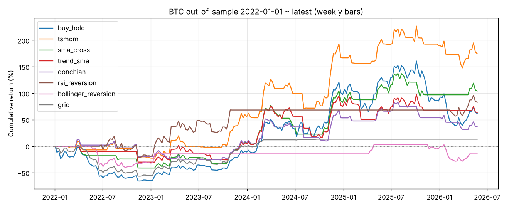
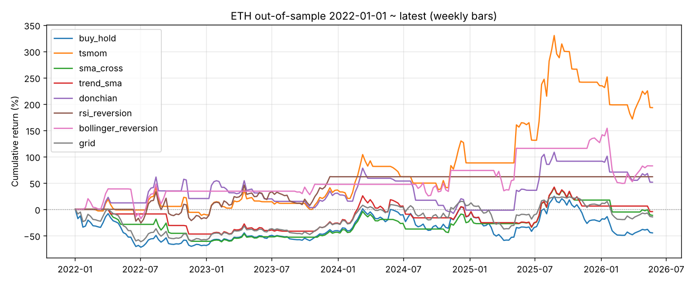

# 策略研究报告：网格 vs 动量 / 趋势 / 均值回归

由 `python -m money_seeker research --out-dir reports` 生成，完整数字见 [`research_table.csv`](research_table.csv)。

## 数据与方法

- **数据**：Coin Metrics 社区版每日 USD 收盘价（GitHub 公开托管），BTC、ETH。
  只有收盘价，回测**不使用任何日内信息**；周线 = 每周日收盘价。
- **样本内（IS）**：2016-01-01 ~ 2021-12-31，只用 BTC，在参数网格里按夏普比率选出每个策略的一组参数。
- **样本外（OOS）**：2022-01-01 ~ 2026-05-23（数据最新日），参数不再改动。
  这段行情包括 2022 年熊市、2023–2024 年牛市和 2025–2026 年回调。
- **交叉验证**：同一组参数原样搬到 ETH 的 OOS 上。
- **成本**：单边 0.1% 手续费。现货只做多，仓位只有满仓（1）或空仓（0）两种，不加杠杆。
- **成交**：主结果按“信号所在 K 线的收盘价成交”计算，另外做了两种延迟检验：
  - `lag1`：晚一根 K 线成交（周线就是晚一整周，非常保守）；
  - `next_day_exec`：周日收盘出信号、周一收盘按日线成交，最接近实盘。
- 年化：日线按 365 天，周线按 52 周。

## 结论

### 1. 网格：放大到周线仍然不行

| 周期 | IS 选出的参数 | BTC OOS 收益 | BTC OOS 夏普 | ETH OOS 收益 | OOS 盈利的参数组合占比 |
| --- | --- | --- | --- | --- | --- |
| 日线 | ±30%，10 格，每 30 天重布 | -18% | -0.07 | -68% | 25% |
| 周线 | ±30%，10 格，不重布 | +13% | 0.25 | -14% | 25% |
| 买入持有 | | +61% | 0.47 | -44% | |

周线网格在 BTC 上的 +13% 并不是网格本身赚的：2024 年价格突破区间上沿后网格全部卖光，此后一直空仓（2025、2026 年收益都是 0）。
24 组参数里只有 1/4 在 OOS 盈利，夏普中位数为负。网格的收益来自震荡，而 BTC/ETH 在周线及更大周期上主要是趋势行情，网格在这里没有优势。

### 2. 找到的盈利策略：周线时间序列动量（4 周）

规则：每周日收盘看过去 4 周的涨跌幅，为正就满仓持有，否则空仓。

| | BTC OOS 总收益 | 年化 | 夏普 | 最大回撤 | ETH OOS 总收益 | ETH 夏普 | ETH 最大回撤 |
| --- | --- | --- | --- | --- | --- | --- | --- |
| **周线动量 4 周** | **+175%** | 26% | **0.83** | **-29%** | **+193%** | **0.73** | -38% |
| 买入持有 | +62% | 12% | 0.47 | -66% | -45% | 0.14 | -72% |

- 参数只用 BTC 2016–2021 选出，在 2022 年之后的 BTC 和**从未参与选参的 ETH** 上，收益、夏普、回撤三项都好于买入持有。
- 周日出信号、周一收盘成交时，BTC OOS 夏普为 0.74，仍然好于买入持有。
- 分年度看（BTC）：2022 年 -21%（买入持有 -65%），2023 年 +99%，2024 年 +71%，2025 年 +9%（买入持有 -6%）。它主要靠躲开熊市赚钱，牛市里跑输买入持有。

### 3. 其他策略（周线，BTC OOS）

| 策略 | 参数 | 总收益 | 夏普 | 最大回撤 | ETH 总收益 |
| --- | --- | --- | --- | --- | --- |
| 均线交叉 | 4/12 周 | +104% | 0.64 | -41% | -11% |
| 趋势过滤 | 20 周均线 | +63% | 0.48 | -34% | -4% |
| 唐奇安突破 | 4/2 周 | +37% | 0.39 | -35% | +51% |
| RSI 回归 | 30 买 / 70 卖 | +83% | 0.59 | -33% | +62% |
| 布林带回归 | 20 周, 2σ | -14% | -0.02 | -40% | +83% |

RSI 回归的数字好看，但 2024 年之后一直空仓，整个 OOS 只成交了寥寥几笔，算不上可靠的策略。
日线版本的各个策略在 OOS 上都赚钱，但没有一个在 BTC 上的夏普超过买入持有，搬到 ETH 上大多亏损。

## 需要警惕的地方

- **参数敏感**：按周一收盘成交检验周线动量的全部回看期：

  | 回看期（周） | 4 | 8 | 13 | 26 | 52 | 买入持有 |
  | --- | --- | --- | --- | --- | --- | --- |
  | BTC OOS 夏普 | 0.74 | 0.33 | 0.66 | 0.68 | 0.87 | 0.47 |
  | ETH OOS 夏普 | 0.73 | 0.53 | -0.03 | -0.17 | 0.13 | 0.16 |

  BTC 上 5 档全部盈利，其中 4 档跑赢买入持有；ETH 上只有 4 周和 8 周两档赚钱，13/26/52 周是亏的（不过都比买入持有亏得少）。
  4 周这一档在两个币上都成立，但“只有短回看期在 ETH 上有效”说明优势没有到稳健的程度。
- **执行时点敏感**：晚一整周才成交时，BTC OOS 夏普从 0.83 掉到 0.22。信号出来后要及时执行。
- **多重检验**：一共比较了 7 类策略 × 2 个周期 × 几十组参数，跑得越多，偶然碰上“好结果”的概率越大。
  样本外检验和换币种验证能降低这个风险，但不能消除。
- **样本外只有 4 年多、约 230 根周线**，统计意义有限；也只覆盖了两个高度相关的币种。
- 没有考虑滑点、资金费率、税费和交易所风险。

**结论**：在这套数据上，周线 4 周动量是唯一同时满足以下三个条件的策略，值得继续研究：样本外盈利、跑赢买入持有、换币种仍然有效。
但它不是“确定能赚钱”的策略，下一步建议加入更多币种和更长的样本外期再验证，然后用小资金模拟盘跟踪。本报告不构成投资建议。

> **后续更新：多币种验证没有通过。** 在 23 个选参时没用过的币上，2022 年以来只有 6 个币赚钱。
> 去掉极端值 ZEC 后，等权组合收益约为 0，夏普与买入持有持平。
> 安慰剂检验显示近几年的择时能力很弱，它的价值主要在于减小回撤。详见 [universe.md](universe.md)。
>
> **再后续：横截面动量轮动也没有通过。** 每周持有涨幅前 K 名的币，在 42 币池（含 FTT 等崩盘币）上样本外亏 62%，选币能力接近随机。详见 [rotation.md](rotation.md)。
>
> **资金费率：** 期现套利（买现货 + 做空永续）是唯一每年都赚钱的策略，但熊市里收益接近美债，主要风险在交易所对手方。资金费率择时无效。详见 [funding.md](funding.md)。
>
> **链上数据：** 活跃地址、交易所余额、算力类信号样本外失败。MVRV 类估值信号在 BTC 上事后漂亮，但样本外只有 1 笔交易，固定阈值已随周期顶部降低而失效，换到其他币也没有优势。详见 [onchain.md](onchain.md)。
>
> **期现套利细化（2025–2026 数据）：** 资金费率已降到年化约 2%。2026 年 BTC/ETH 期现套利扣成本后年化 1–2%，低于 3 个月美债，现在不值得做。详见 [carry.md](carry.md)。
>
> **持有 BTC 的增强操作：** “50% 核心 + 50% 跟随 200 日均线”长期年化比买入持有高约 9 个百分点、回撤更小，但在 V 型反弹和持续牛市里会少赚；合成多头基本没有超额；备兑看涨长期跑输。详见 [btc.md](btc.md)。
>
> **抵押 BTC 借款：** 借钱买美债或做套利不划算，借钱加仓后一直持有容易在熊市被强平。只在上涨趋势里借（不超过核心价值的 50%）、趋势转弱就还清，历史上长期年化约多 5 个百分点。详见 [loan.md](loan.md)。
>
> **操作手册：** 三种方案（买入持有 / 核心 + 趋势 / 再加上涨时借款）在 2014、2022、2026 年起点的对比，以及每天怎么执行，见 [playbook.md](playbook.md)。

## 图

样本外累计收益（周线）：

日线版本见 `research_D_btc.png`、`research_D_eth.png`。
