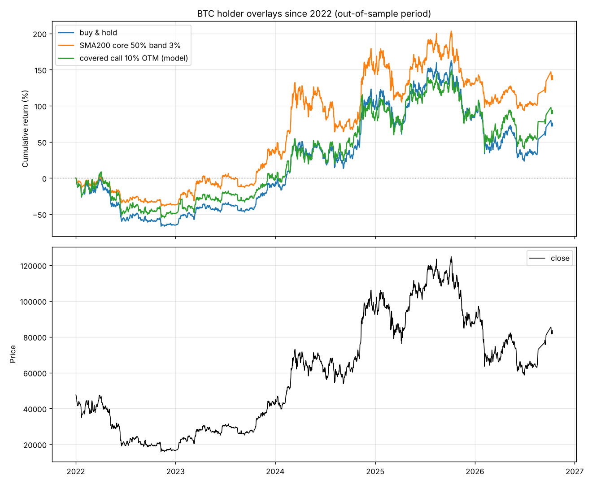

# 持有 BTC 时怎么多赚一点

由 `python -m money_seeker btc --out-dir reports` 生成。完整数字见：
- `btc_synthetic_vs_spot.csv`：现货 vs 合成多头；
- `btc_covered_call.csv`：备兑看涨；
- `btc_trend_overlay.csv`：部分趋势仓位；
- `btc_yearly.csv`：逐年收益；
- `btc_rally_2026.json`：2026 年夏季上涨期间各做法的收益。

## 问题

期现套利是**现金**的替代品（不承担 BTC 涨跌），不是 BTC 持仓的替代品。做套利就放弃了 BTC 本身的涨幅，比如 2026-06-30 的 $58.4k 到 10 月中旬的 $83.8k（+44%）。

所以这一轮的问题是：**持有 BTC、保留（大部分）上涨敞口的前提下，怎样能多赚一点？**

## 数据

- **BTC 价格**：Coin Metrics 日收盘价（到 2026-05-23），之后用 Binance 永续标记价格接到 2026-10-12。
  标记价格与现货价平均只差 0.04%。2026 年 8–10 月数据源有中断，跨中断的收益按中断前后的价格计算。
- **资金费率**：Binance BTCUSDT，2020–2023 年，以及 2025-08 起。
- **无风险收益**：3 个月美债。
- **期权**：没有可访问的历史隐含波动率，备兑看涨用模型估算（见下文）。

## A. 现货 vs 合成多头：基本没有超额

同样 1 倍 BTC 敞口，可以直接拿现货，也可以“现金买美债 + 1 倍永续多单”（合成多头）。BTC 涨跌两边一样，差别只在于“美债利息 − 资金费 − 切换成本”。

**合成多头相对现货的年化超额收益：**

| 规则 | 2020 | 2021 | 2022 | 2023 | 2025 下半年 | 2026 |
| --- | --- | --- | --- | --- | --- | --- |
| 一直用合成多头 | -17.3% | **-30.8%** | -2.4% | -3.0% | -1.2% | +1.0% |
| 30 天资金费 < 利息 − 2% 时切换 | -0.2% | -0.4% | -0.4% | -0.1% | 0.0% | +0.9% |
| 7 天资金费 < 利息时切换 | -1.4% | -1.0% | -4.9% | -3.0% | -1.7% | +0.6% |

- **牛市里资金费很高**（2021 年年化约 31%），一直用合成多头每年少赚 30%。
- **按条件切换**：资金费会突然跳升，切换一次的成本约 0.19%，所以各种切换规则在 2020–2023 年都是负超额，2025–2026 年也只有 -2.5% 到 +0.9%。
- **托管风险**：合成多头还要求把全部资产放在交易所，而现货可以自己托管。

**结论：不值得做。**

## B. 备兑看涨（covered call）：用上涨换权利金

**做法**：每 30 天卖一张 30 天到期的虚值看涨期权，收取权利金；BTC 涨过行权价的部分要付出去。

**模型假设**：
- 隐含波动率 = 过去 30 天实际波动率 × 系数（1.0 / 1.15 / 1.3）。BTC 的隐含波动率长期略高于实际波动率，1.15 左右比较常见；
- 成本：Deribit 期权手续费，加上权利金的 3% 作为买卖价差；
- 这是模型估算，真实的隐含波动率和波动率偏斜会让结果有出入。

**2014-06 ~ 2026-10，波动率系数 1.15**（买入持有年化 48.7%）：

| 行权价比现价高 | 年化收益 | 夏普 | 最大回撤 | 期末 BTC 数量（初始 1） |
| --- | --- | --- | --- | --- |
| 5% | 30.2% | 0.75 | -82% | 0.21 |
| 10% | 33.2% | 0.78 | -84% | 0.27 |
| 20% | 37.8% | 0.82 | -86% | 0.40 |
| 30% | 40.6% | 0.85 | -87% | 0.51 |
| 买入持有 | 48.7% | 0.93 | -84% | 1.00 |

**逐年对比**（行权价高 10%）：
- **暴涨年份损失巨大**：2017 年 +201%，而 BTC 是 +1337%；2020 年 +165%，BTC 是 +305%；
- **横盘和下跌年份更好**：2025 年 +16.5%，BTC 是 -6.3%；2022 年 -42%，BTC 是 -64%。

**最近几年反而占优**：

| | 2022 年起年化 | 2024 年起年化 |
| --- | --- | --- |
| 买入持有 | 12.3% | 26.1% |
| 行权价高 10% | 14.6% | 30.7% |
| 行权价高 20% | 19.0% | 26.1% |

原因是 2022 年以来没有出现单月暴涨的行情：今年夏天的上涨是逐月慢慢涨上去的，行权价高 20% 的版本完整吃到了涨幅（+40.3%，BTC 是 +39.6%），行权价高 10% 的版本是 +31.6%。

**结论**：备兑看涨在暴涨的月份会让你**错过行情**，这恰恰是你担心的问题。
- 长期看（包含 2017、2020 这类暴涨年），收益明显低于买入持有；
- 只在“BTC 波动变小、不再暴涨”的情况下有利；
- 数字依赖波动率假设：系数 1.3 时才和买入持有打平。

如果要做，只建议拿**一小部分仓位**，卖**行权价高 20–30%** 的看涨期权。

## C. 部分趋势仓位：唯一在完整周期里同时提高收益、降低回撤的做法

**规则**：
- 价格在 200 日均线上方时，100% 持有 BTC；
- 价格在均线下方时，只保留 50% 核心仓位，另外 50% 换成美债；
- 加 3% 缓冲区：涨破均线 × 1.03 才加满，跌破均线 × 0.97 才减仓，减少来回切换；
- 收盘出信号，次日收盘成交，单边手续费 0.1%。

200 日均线是最常用的参数，**没有在这份数据上优化过**。

| 区间 | 做法 | 年化收益 | 夏普 | 最大回撤 | 平均 BTC 仓位 | 调仓次数 |
| --- | --- | --- | --- | --- | --- | --- |
| 2014-06 ~ 2026-10 | 买入持有 | 48.7% | 0.93 | -84% | 100% | 0 |
| | **200 日均线，核心 50%，缓冲 3%** | **57.6%** | **1.10** | **-74%** | 79% | 35 |
| 2022 ~ 2026-10 | 买入持有 | 12.3% | 0.48 | -67% | 100% | 0 |
| | **200 日均线，核心 50%，缓冲 3%** | **20.2%** | **0.67** | **-40%** | 75% | 14 |
| 2024 ~ 2026-10 | 买入持有 | **26.1%** | 0.72 | -53% | 100% | 0 |
| | 200 日均线，核心 50%，缓冲 3% | 21.7% | 0.70 | **-36%** | 79% | 10 |

**逐年**：

| | 2018 | 2019 | 2020 | 2021 | 2022 | 2023 | 2024 | 2025 | 2026 |
| --- | --- | --- | --- | --- | --- | --- | --- | --- | --- |
| 趋势仓位 | -60% | +77% | +255% | +40% | **-36%** | +114% | +83% | -6% | **+3%** |
| 买入持有 | -74% | +94% | +305% | +60% | -64% | +156% | +121% | -6% | -7% |

**稳健性**：
- 换成 140 日均线、每周检查一次、去掉缓冲区，2022 年以来的年化在 14–21% 之间，**都高于买入持有的 12.3%**，说明不是靠某个特定参数凑出来的；
- 不过 2024 年以来，多数版本略低于买入持有。

**代价**：
- **在 V 型反弹里会慢一拍**。今年 6 月底见底后，价格到 8 月 19 日才重新站上 200 日均线，这段上涨里趋势仓位赚了 +22.5%，BTC 是 +39.6%；
- 2024 年这种持续上涨的牛市里，它也会因为中途几次回调减仓而少赚。

**超额从哪里来**：
- 主要来自**少亏**：2018 和 2022 两次熊市里，一半仓位躲在美债里；
- 15 年里只有 3–4 次大熊市，样本不大。它是“降低回撤、牺牲部分牛市收益”的交换，而不是稳赚的超额收益。

**税务**：每次减仓都要卖出 BTC，在很多地区属于应税事件。实际收益要扣税，这里没有计入。

## 总结：持有 BTC 时怎么做

| 做法 | 保留上涨 | 结论 |
| --- | --- | --- |
| 期现套利 | ❌ 完全放弃 | 2026 年跑输美债，不适合作为 BTC 持仓的替代 |
| 合成多头（美债 + 永续多单） | ✅ 全部 | 超额 -2% 到 +1%，还要把资产放在交易所，不值得 |
| 备兑看涨 | ⚠️ 暴涨月份封顶 | 长期跑输；最近几年模型显示占优。可以用小部分仓位卖行权价高 20–30% 的看涨期权 |
| **部分趋势仓位** | ✅ 至少保留 50%，上涨趋势中 100% | **长期年化 +9 个百分点、回撤更小**；V 型反弹和持续上涨的牛市里会少赚 |

**建议**：如果目标是“既不错过大行情，又比死拿多一点”，可以采用**核心 + 卫星**的结构：
- 50% 核心仓位**永远持有**，可以自己托管；
- 另外 50% 跟随 200 日均线（带 3% 缓冲区）进出，不持有 BTC 时这部分放美债或美债货币基金；
- 每年调仓约 3 次。

这不是无风险的超额收益：它用“熊市少亏”换来了更高的长期收益，代价是 V 型反弹和持续牛市里会少赚。核心比例可以按自己对回撤的承受度调整：
- 核心 70%：更接近买入持有；
- 核心 0%：回撤最小，但更容易错过反弹。

本报告不构成投资建议。

## 图

2022 年以来三种做法的对比（备兑看涨为模型估算）：

