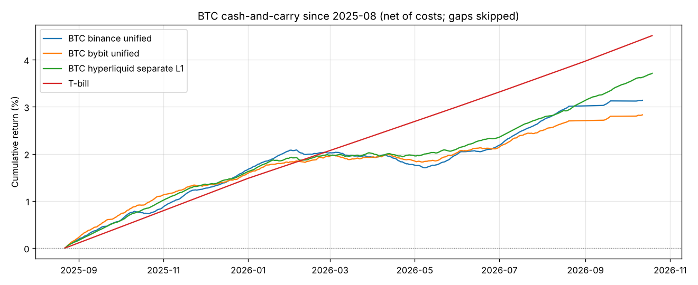

# 期现套利细化：补上 2025–2026 数据

由 `python -m money_seeker carry --out-dir reports` 生成。完整数字见以下文件：
- `carry_yearly.csv`：逐年 × 交易所 × 账户模式；
- `carry_cross_section.csv`：各币资金费率；
- `carry_rotation.csv`：轮动；
- `carry_risk.csv`：基差与安全杠杆。

这一轮在[资金费率报告](funding.md)的基础上，补上近期数据，并把成本、资金利用率、爆仓风险、基差、选币都算细。

## 数据

| 时间段 | 来源 | 交易所 | 币种 |
| --- | --- | --- | --- |
| 2020-01 ~ 2023-12 | [supervik/historical-funding-rates-fetcher](https://github.com/supervik/historical-funding-rates-fetcher) | Binance、Bybit（2021 起）、Gate | BTC、ETH |
| **2024-01 ~ 2025-08** | **没有可用的公开数据，保留为缺口，不做填补** | – | – |
| 2025-08-21 ~ 2026-10-20 | [ZuShen168/funding_rate_data](https://github.com/ZuShen168/funding_rate_data) | Binance、Bybit（8h/4h 结算）、Hyperliquid（每小时结算） | 18–21 个币，含 Binance 标记价格 |
| 2026-03 ~ 2026-06（交叉核对） | [powakadata 免费样本](https://github.com/powakadata/powakadata-crypto-funding-sample) | Binance | 8 个币 |

- **为什么有缺口**：这个环境的网络策略屏蔽了所有交易所接口，只能用 GitHub 上公开的数据。要补上缺口，需要在环境设置里放行交易所域名，或者在本地运行拉取脚本。
- **数据核对**：两个独立来源在 2026 年 3–6 月有重叠，Binance BTC/ETH 的 377 次结算，资金费率和标记价格**完全一致**。
- **数据中断**：Binance、Bybit 在 2026-08-21 ~ 09-13 和 09-20 ~ 10-06 有两段中断。中断的日子不计收益，也不计入年化天数。
- **无风险基准**：3 个月美债，来自 [FRED TB3MS](https://fred.stlouisfed.org/series/TB3MS) 和 [Macrotrends](https://www.macrotrends.net/3078/3-month-treasury-bill-rate)。2023 年约 5.1%，2024 年约 5.0%，2025 年 4.07%，2026 年 1–9 月为 3.6–3.9%。

## 模型

**成本**：
- 现货 taker 0.1%；
- 永续 taker：Binance 0.05%、Bybit 0.055%、Hyperliquid 0.045%；
- 滑点：BTC/ETH 每条腿 0.02%，山寨币 0.05%；
- 每段建仓、平仓各一次。

**账户模式**：
- **unified（统一账户）**：现货直接作空单保证金，留 10% 缓冲，名义仓位约为资金的 91%；
- **separate（分账户）**：现货和合约保证金分开，空单杠杆 L，名义仓位 = L / (L+1)。
  - 价格相对上次调仓偏离 10% 时，把现货盈利挪去补保证金，两条腿各交易一次，计成本；
  - 同时记录历史上离强平最近的程度。
- Hyperliquid 没有对应的现货，现货腿需要放在别的交易所，所以只能用分账户模式。

## 结果

### 1. 资金费率已经降到很低

毛资金费率（年化，没有扣任何成本）：

| | 2021 | 2023 | 2025 下半年 | **2026（1–10 月）** |
| --- | --- | --- | --- | --- |
| BTC Binance | 30.6% | 7.9% | 5.1% | **2.4%** |
| BTC Bybit | 38.3% | 8.9% | 4.8% | **2.0%** |
| BTC Hyperliquid | – | – | 9.2% | **5.2%** |
| ETH Binance | 37.5% | 8.3% | 4.1% | **1.3%** |
| ETH Hyperliquid | – | – | 8.3% | **5.9%** |
| 3 个月美债 | 0.05% | 5.1% | 4.1% | 3.65% |

Hyperliquid 的资金费率比中心化交易所高约 3–4 个百分点。主要原因是它的资金费公式里有一个固定的利率项。

### 2. 扣除成本后，2026 年跑输美债

净收益（年化）：

| | 2023 | 2025 下半年 | **2026** |
| --- | --- | --- | --- |
| BTC Binance 统一账户 | 7.0% | 3.7% | **1.7%** |
| BTC Bybit 统一账户 | 8.0% | 3.5% | **1.3%** |
| BTC Binance 分账户 1 倍 | 3.6% | 1.9% | 0.8% |
| BTC Hyperliquid 分账户 1 倍 | – | 4.0% | 2.4% |
| BTC Hyperliquid 分账户 2 倍 | – | 5.4% | 3.2% |
| ETH Binance 统一账户 | 7.4% | 2.8% | 0.7% |
| ETH Hyperliquid 分账户 2 倍 | – | 4.7% | 3.4% |
| **3 个月美债** | 5.1% | 4.1% | **3.65%** |

说明：每段都单独计了一次建仓和平仓，所以较短的段收益偏保守。

如果从 2025-08 起连续持有、只建仓平仓一次（见文末的图），BTC 在约 14 个月里扣成本后累计赚了：
- Binance 统一账户 3.1%，Bybit 2.8%，Hyperliquid 分账户 1 倍 3.7%；
- 同期美债约 4.5%。

结论：
- 2023 年期现套利还能比美债多 2–3 个百分点；
- 2025 下半年已经大致打平；
- **2026 年，所有现实可行的配置都跑输美债**，同时还要承担交易所风险。
- Hyperliquid 加 2 倍杠杆勉强接近美债，但要同时承担两家平台的风险（其中一家是链上合约平台），而且没法统一保证金。

### 3. 换成山寨币或轮动不会更好

**各币 2026 年的资金费率（年化）**：
- Binance 上最高的是 LINK（4.4%），也不到美债水平；
- 很多币是**负费率**，即做空方付钱：INJ -16.0%、SEI -10.0%、TRX -8.5%、TON -7.5%、APT -7.4%；
- Hyperliquid 上最高的 NEAR、LINK 约 10%。

**按资金费率轮动**：每周选过去 14 天资金费率最高的 3 个币。以下为名义仓位 1 倍、扣成本后的年化：

| 交易所 | 只做 BTC | 等权全部币 | 前 3 名，每周换 | 每 4 周换 | 每 13 周换 |
| --- | --- | --- | --- | --- | --- |
| Binance | **3.0%** | -1.7% | -8.6% | -2.4% | 2.3% |
| Bybit | **2.5%** | -0.8% | -8.8% | -1.2% | 1.6% |
| Hyperliquid | 6.1% | 2.5% | 1.8% | 5.3% | 6.6% |

- **资金费率本身是有持续性的**：本周排前 3 的币，下周仍比平均高出几个百分点（排名相关系数 0.5–0.6）。不计成本时，Binance 前 3 名轮动的年化是 3.9%，比只做 BTC 的 3.2% 略高。
- **但换一次币要交易 4 笔，成本约为名义仓位的 0.5%**，远远吃掉这点优势。
- 降低换币频率后，最多与只做 BTC 打平。而且山寨币空单有轧空风险：例如 ORDI 在 2026-04-16 一天内从 $2.44 涨到 $8.88（两个合约数据一致），1 倍空单也会被强平。
- 每 4 周、13 周换一次的规则，是在同一段数据上看到每周换不行之后才试的，属于探索性结果。

### 4. 风险细节

**基差**：
- 计算方法：用 Binance 标记价格对比 Coin Metrics 现货价，都取 00:00 UTC。
- 结果：BTC 永续平均比现货低 0.04%，标准差 0.17%，1% / 99% 分位为 -0.74% / +0.25%。ETH 类似。
- 影响：开平仓各付一次基差，通常 ±0.2%，极端时 0.7% 以上。按 2026 年的费率，这相当于 1–2 个月的收益。

**分账户空单的强平**：
- 历史最大单日收盘涨幅（2020–2026）：BTC +18%，ETH +28%。
- 按“价格每偏离 10% 调一次仓 + 1.5 倍历史最大单日涨幅”估算，安全空单杠杆为：**BTC 约 2.6 倍，ETH 约 1.9 倍**。
- 回测核对：ETH 用 3 倍空单在 2021 年**仅按日收盘价就会被强平**；2 倍时最接近强平那次用掉了 72% 的距离，而日内冲高会更大。
- 山寨币风险大得多：ORDI 单日 +176%，SUI +38%，TON +33%。

**收益里没有计入的风险**：
- **交易所倒闭**（FTX）、提币冻结；
- 自动减仓（ADL）把空单强行平掉，套利腿失衡；
- 稳定币脱锚；
- Hyperliquid 的智能合约和预言机风险。

## 结论

1. **资金费率已从 2021 年的 30–40% 降到 2026 年的 2% 左右**。在中心化交易所做 BTC/ETH 期现套利，扣除成本后年化约 1–2%，**低于 3 个月美债的 3.6–3.9%**。
2. 唯一能接近美债的是 **Hyperliquid 做空 + 中心化交易所买现货 + 2 倍空单**（BTC 2026 年净 3.2%），但要承担两家平台的风险，还要主动管理保证金。
3. 换山寨币或按资金费率轮动，成本和轧空风险都更大，结果更差。
4. **因此现在不建议做期现套利**，持有美债或美债类货币基金更好。它只在资金费率大幅回升时值得重新考虑，比如牛市中费率回到 10% 以上。
   一个可以操作的判断标准：过去 30 天 BTC 平均年化资金费率，减去约 1.5% 的年化成本，再减去当期美债收益率，大于 3 个百分点再开仓。

**仍然缺的数据**：
- 2024-01 ~ 2025-08 这段牛市（公开报道中当时资金费率一度很高）没有数据；
- 2026 年 8–10 月有两段中断。

放行交易所域名或在本地运行后，用 `--refresh` 重新拉取即可补全。本报告不构成投资建议。

## 图

从 2025-08 起连续持有 BTC 期现套利（扣成本，中断日不计）与美债的累计收益：

