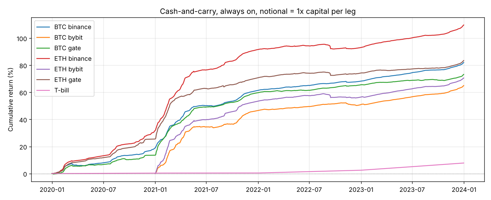

# 资金费率策略

> 更新：补上 2025–2026 数据并细化成本、杠杆、基差后的结果见 [carry.md](carry.md)。2026 年期现套利已跑输美债。

由 `python -m money_seeker funding --out-dir reports` 生成。完整数字见以下文件：
- `funding_carry_yearly.csv`：常开期现套利的逐年收益；
- `funding_carry_grid.csv`：开关条件的参数扫描；
- `funding_timing.csv`：择时策略的参数扫描；
- `funding_timing_selected.json`：样本内选出的择时参数及其检验结果。

## 数据

- **资金费率**：[supervik/historical-funding-rates-fetcher](https://github.com/supervik/historical-funding-rates-fetcher) 公开的 8 小时资金费率，BTC、ETH 的 USDT 永续合约。
  - Binance、Gate：2020-01 ~ 2023-12；Bybit：2021-01 ~ 2023-12。
  - 三家交易所的数据互相吻合，年度水平也符合公开报道（例如 BTC 2021 年全年资金费率合计约 31%）。Gate 有一段 31 天的缺口。
- **现货价格**：沿用 Coin Metrics 每日收盘价。
- **局限**：只有 2 个币、4 年，**没有 2024 年之后的数据**（这个环境访问不了任何交易所的接口）。

## A. 期现套利（cash-and-carry）

买入现货，同时做空等量的永续合约。价格涨跌两边抵消，赚的是资金费：资金费率为正时多头付给空头，为负时空头付钱。
- **手续费**：每次开或平，现货 0.1% 加合约 0.05%，两条腿都收。
- **notional（每条腿名义金额 / 总资金）**：
  - 0.5：一半资金买现货，一半作 1 倍空单保证金，最保守；
  - 1.0：用现货作保证金（统一账户 / 组合保证金），资金利用率翻倍。

### 常开：逐年收益

| 币 | 交易所 | notional | 2020 | 2021 | 2022 | 2023 | 最差 30 天 |
| --- | --- | --- | --- | --- | --- | --- | --- |
| BTC | Binance | 0.5 | 8.9% | 16.5% | 2.1% | 4.0% | -0.7% |
| BTC | Binance | 1.0 | 18.6% | 35.8% | 4.3% | 8.2% | -1.3% |
| BTC | Bybit | 1.0 | – | 46.4% | 3.0% | 9.3% | -1.0% |
| BTC | Gate | 1.0 | 13.3% | 40.7% | 3.7% | 4.6% | -0.6% |
| ETH | Binance | 1.0 | 31.4% | 45.5% | 0.8% | 8.6% | -1.8% |
| ETH | Bybit | 1.0 | – | 53.4% | 2.0% | 9.0% | -1.7% |
| ETH | Gate | 1.0 | 25.1% | 36.2% | 2.1% | 5.3% | -1.4% |
| **3 个月美债（近似）** | | | 0.4% | 0.1% | 2.0% | 5.1% | |

- **它确实赚钱**：6 个“币 × 交易所”组合每一年都是正收益，最差的 30 天也只亏 0.3–1.8%。这是前面四轮研究里**第一个在样本外、跨币种、跨交易所都没有亏过的策略**。
- **但收益高度依赖行情**：资金费率来自多头愿意为杠杆付的溢价。
  - 2020–2021 年牛市年化 15–50%；
  - 2022 年熊市降到 1–4%，和美债差不多；
  - 2023 年 notional=0.5 时只有 2–4%，**跑输美债的 5.1%**；notional=1.0 时才有 5–9%。

### 条件开关：没有带来任何改进

想法是：最近资金费率高时开仓，低或为负时平仓，躲开付费期。在 Binance BTC 上扫了 34 组参数（窗口 1/3/7 天 × 开仓阈值 × 平仓阈值），notional=0.5：

| | 2020–21 年化 | 2022–23 年化 |
| --- | --- | --- |
| 常开 | 12.7% | 3.1% |
| 样本内最好的开关参数 | 12.6% | 2.9% |
| 开关参数样本外中位数 | – | 1.0% |

开关省下的负资金费，抵不过来回开平仓的手续费和错过的正资金费。**直接常开就是最好的做法。**

### 回测没有包含的风险（实盘最重要的部分）

1. **交易所对手方风险**：2022 年 11 月 FTX 倒闭，放在上面的套利仓位全部归零。
   这里的三家交易所都活了下来，本身就是一种幸存者偏差。一次交易所事故就能抹掉多年收益。
2. **强平风险**：空单在暴涨时保证金会被打穿。尤其 notional=1.0、两条腿不在同一个保证金账户时，要预留缓冲。
3. **基差**：开仓和平仓时，现货与永续价格之间的价差（基差）会带来额外损益，这里没有计入（没有永续价格数据）。
4. **容量与拥挤**：这是公开、被大量资金（包括 Ethena 这类产品）在做的交易。资金越多，资金费率越被压低。

## B. 资金费率择时（现货只做多）

**两类规则**：
- **overheat**：平时持有现货，最近 N 天平均资金费率过高（多头拥挤）时空仓；
- **contrarian**：只在资金费率偏低或为负（恐慌）时买入，过高时卖出。

**方法**：共 34 组参数，在 BTC 2020–2021 上按夏普选参数，在 2022–2023 上检验，同时用 ETH 交叉验证。信号额外延迟 1 天成交。

| 选出的规则：contrarian，7 天均值 < 0.01% 买入，> 0.02% 卖出 | 收益 / 夏普 | 买入持有 | 持仓时间占比 | 安慰剂分位 |
| --- | --- | --- | --- | --- |
| BTC 2020–21（选参） | +626% / 2.40 | +426% / 1.50 | 49% | 0.99 |
| **BTC 2022–23** | -8% / 0.19 | -11% / 0.17 | **99%（只交易 1 次）** | 0.77 |
| **ETH 2020–21（同期，未参与选参）** | **+305% / 1.54** | **+2123% / 2.09** | 42% | **0.56** |
| ETH 2022–23 | -46% / -0.11 | -39% / -0.01 | 99% | 0.29 |

- **样本外根本没有被检验到**：2022–2023 年资金费率一直很低，7 天均值超过 0.02% 的只有 6 天。所以规则几乎全程满仓，和买入持有没有区别。
- **同期换到 ETH 就失效**：BTC 上看起来很好的规则，放到 ETH 2020–2021 只赚了 +305%，而买入持有是 +2123%。安慰剂分位 0.56，与随机无异。
- **结论：没有证据表明资金费率能预测方向。**

## 总结

| 策略 | 结论 |
| --- | --- |
| 期现套利，常开 | **能赚钱**，回撤极小；但本质是赚风险溢价而不是预测。熊市里收益接近或低于美债，主要风险在交易所和强平，回测里看不到 |
| 期现套利，条件开关 | 不如常开 |
| 资金费率择时 | 没有证据有效 |

如果要实际做期现套利，建议：
- 只在可信的大交易所做，并分散到几家；
- 用统一保证金账户，并留出足够的保证金缓冲；
- 把它当作“比美债多一点、但带交易所风险”的现金管理工具，而不是高收益策略；
- 补上 2024 年以后的数据（需要能访问交易所接口的网络）再验证近期收益水平。

本报告不构成投资建议。

## 图

