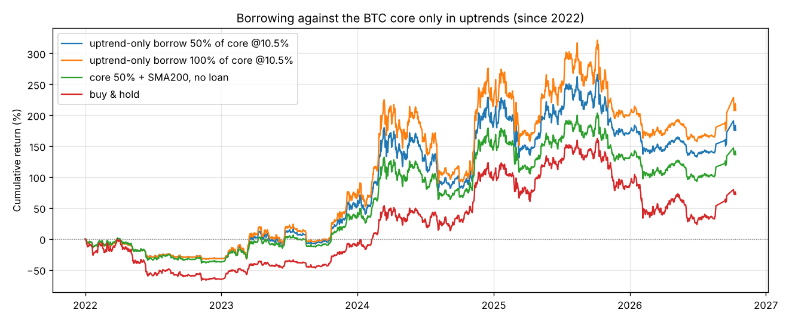

# 用长持的 BTC 作抵押借钱，能不能多赚？

由 `python -m money_seeker loan --out-dir reports` 生成。完整数字见：
- `loan_liquidation_risk.csv`：强平概率；
- `loan_strategies.csv`：各种借款方案的收益；
- `loan_uptrend_margin.csv`：只在上涨趋势里借款时离强平有多远。

承接 [btc.md](btc.md) 里“50% 核心长持 + 50% 跟随 200 日均线”的方案，问题是：**核心那 50% 能不能拿去抵押借钱，创造额外收益？**

## 先看利率：借来的钱干什么才划算

**借款利率**（2026 年 9–10 月，各来源说法不一，以平台实时报价为准）：

| 渠道 | 利率 | 强平线 |
| --- | --- | --- |
| Aave 等链上借贷，用 WBTC / cbBTC 作抵押 | 浮动约 3.3–6.2%，牛市时会明显上升 | 约 78–80% |
| Ledn 等中心化平台 | 固定 9.99–11.49% | 80% |
| Nexo | 10.9–17.9%，持有平台币才能更低 | – |

**借来的钱能做什么：**

| 用途 | 年化收益 | 减去借款成本 |
| --- | --- | --- |
| 买 3 个月美债 | 3.6–3.9% | 链上最便宜时约打平；中心化平台每年亏 6–7% |
| 做期现套利 | 1–2%（见 [carry.md](carry.md)） | 亏 |
| **买更多 BTC** | BTC 的收益 | 本质是加杠杆 |

**BTC 本身生息**：Babylon 原生质押年化约 0.04–0.6%，而且奖励是 BABY 代币而不是 BTC；其他 BTC 理财产品的利率数据互相矛盾，查不到可靠的数字。基本可以忽略。

**结论**：借钱去买“稳的”资产，利息基本覆盖不了借款成本。抵押借款唯一能多赚的方式是**买更多 BTC，也就是加杠杆**。

## 强平风险：借了不管，有多危险

从 2014-06 起的每个起点借款，之后不还、不补仓，利息累加到负债上，统计在一定时间内被强平的比例。只用日收盘价，看不到日内插针，真实风险会更高。

| 初始借款比例（LTV） | 跌多少会被强平 | 1 年内被强平 | 2 年内 | 3 年内 |
| --- | --- | --- | --- | --- |
| 10% | 88% | 0% | 0% | 0% |
| 20% | 75% | 1% | 3–4% | 3–4% |
| **30%** | 62% | **10–12%** | **16–18%** | **17–20%** |
| 40% | 50% | 24–26% | 30–31% | 33–34% |
| 50% | 38% | 35–36% | 38% | 42% |

LTV 30% 时，历史上最快在借款后 **49 天**就被强平。

## 方案对比

所有方案都从“1 份资金”开始，比较年化收益和最大回撤。

| 起点 | 方案 | 年化收益 | 最大回撤 | 强平 |
| --- | --- | --- | --- | --- |
| 2014-06 | 买入持有 | 48.7% | -84% | – |
| | 核心 50% + 200 日均线，不借款 | 57.6% | -74% | – |
| | 借 BTC 价值的 30% 加仓，然后一直持有 | 26.3% | **-97%** | **2015-01 被强平** |
| | **只在上涨趋势里借款**，借核心价值的 50%（利率 5% / 10.5%） | **63.2% / 62.7%** | -71% | 无 |
| | 只在上涨趋势里借款，借核心价值的 100% | 68.2% / 67.0% | -71% | 无 |
| 2018-01 | 买入持有 | 23.1% | -81% | – |
| | 核心 50% + 200 日均线，不借款 | 28.5% | -70% | – |
| | 借 30% 加仓后持有 | -2.2% | -98% | 2018-11 被强平 |
| | 只在上涨趋势里借核心的 50%（10.5%） | 29.0% | -75% | 无 |
| 2022-01 | 买入持有 | 12.3% | -67% | – |
| | 核心 50% + 200 日均线，不借款 | 20.2% | -40% | – |
| | 借 50% 加仓后持有 | -24.4% | -95% | 2022-06 被强平 |
| | 只在上涨趋势里借核心的 50%（10.5%） | 24.2% | -37% | 无 |
| 2024-01 | 买入持有 | 26.1% | -53% | – |
| | 核心 50% + 200 日均线，不借款 | 21.7% | -36% | – |
| | 只在上涨趋势里借核心的 50%（10.5%） | 23.5% | -38% | 无 |

### 借钱加仓后一直持有：不要做

- 借款比例到 30% 以上，2014、2018、2022 年开始的三次都会在熊市被强平。被强平就会永久失去核心仓位，而核心仓位本来就是“永远不卖”的那部分。
- 借 20% 时没有被强平，但最大回撤从 -84% 加深到 -88% 至 -94%。

### 只在上涨趋势里借款：和你的方案配合得很好

**规则**：
- 价格涨破 200 日均线 × 1.03（趋势仓位买回 BTC 时）：以全部 BTC 作抵押，借款金额 = 核心仓位价值的 50%，再买入 BTC；
- 价格跌破 200 日均线 × 0.97（趋势仓位卖出时）：用卖出得到的钱**先还清借款**，剩下的放美债。

**为什么安全很多**：熊市里不背负债，而大跌通常发生在跌破均线之后，那时借款已经还清。

| 借款金额（占核心价值） | 借款时 LTV | 历史最高 LTV | 离强平还能再跌 | 3 年区间跑赢不借款的比例（利率 10.5%） | 最差的 3 年 |
| --- | --- | --- | --- | --- | --- |
| **50%** | 20% | 24%（2020-03-09） | **70%** | 95% | 财富为不借款的 0.85 倍 |
| 100% | 33% | 40% | 50% | 93% | 0.61 倍 |
| 150% | 43% | 52% | 35% | – | – |

- 借核心价值的 50%（总敞口在上涨趋势里约为 125%），长期年化多赚约 5 个百分点（63% 对 57%），最大回撤基本不变。即使用中心化平台 10.5% 的利率也成立。
- **2020 年 3 月是最接近出事的一次**：LTV 最高的那天是 3 月 9 日，随后趋势信号触发、借款还清，然后才是 3 月 12 日单日 -37% 的暴跌。如果暴跌早几天发生：
  - 借 100% 的版本 LTV 会冲到约 66%，接近强平；
  - 借 50% 的版本大约 38%，仍然安全。
- 2024 年以来的持续上涨里，它介于“不借款”和“买入持有”之间（23.5%），比不借款多赚一点，仍然少于死拿。

## 回测里没有的风险

1. **平台风险**：2022 年 Celsius、BlockFi 倒闭，用户的抵押品血本无归。链上借贷有智能合约和预言机风险；WBTC / cbBTC 还有托管方风险。**核心仓位一旦拿去抵押，就不再是“自己托管、永远安全”的那部分了。**
2. **浮动利率**：Aave 的稳定币借款利率在牛市里可能升到 10–20%，正好是借款期间。
3. **日内插针**：回测只用日收盘价，看不到日内插针。设置强平线时要多留余量。
4. **税务**：抵押借款通常不算卖出，不产生资本利得税，这是它相对“卖币换钱”的真正好处；利息一般不能抵税。各地规定不同。

## 结论

1. **借钱去买美债、做套利、放稳定币理财：不划算**。借款利率基本都高于这些收益。
2. **借钱加仓后一直持有：不要做**。借款比例 30% 以上时，历史上每轮熊市都会被强平，核心仓位就没了。
3. **如果想用核心仓位创造额外收益，唯一经得起历史检验的做法是“只在上涨趋势里借款”**：
   - 借款金额不超过核心价值的 50%（借款时 LTV 约 20%）；
   - 趋势仓位一卖出，就先用这笔钱把借款还清；
   - 选可信的平台，优先选利率低的渠道；
   - 历史上长期年化约多 5 个百分点，回撤基本不变，熊市里不背负债。
4. 本质上这仍是**加杠杆**，不是无风险收益：它把“上涨趋势里的仓位”从 100% 放大到约 125%。如果更在意核心仓位的绝对安全（自己托管、不承担平台风险），不借款也完全合理。

本报告不构成投资建议。

## 图

2022 年以来，只在上涨趋势里借款与不借款、买入持有的对比：

