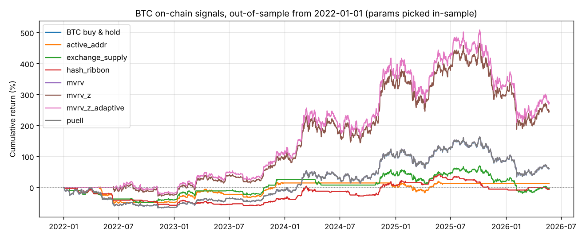

# 链上数据策略

由 `python -m money_seeker onchain --out-dir reports` 生成。完整数字见以下文件：
- `onchain_scan.csv`：全部信号 × 参数的结果；
- `onchain_selected.csv`：每类信号在样本内选出的参数；
- `onchain_mvrv_cross_coin.csv`：MVRV 类规则在其他币上的表现；
- `onchain_trades_btc_mvrv_z.csv`：BTC 上 MVRV Z 策略的全部交易。

## 数据与方法

- **数据**：Coin Metrics 社区版每日链上指标（GitHub 公开），BTC 从 2010–2012 年起，ETH 从 2015 年起，到 2026-05-23。
- **方法**：
  - **选参**：每类信号在 BTC 2012–2021（约 3 个牛熊周期）上按夏普选一组参数；
  - **检验**：在 2022-01 ~ 2026-05 的 BTC 上检验；
  - **交叉验证**：同一组参数搬到 ETH，以及另外 32 个有 MVRV 数据的币上。
- **执行**：现货只做多。指标是当天收盘后才算出的，所以**次日收盘才成交**；手续费 0.1%。

| 信号 | 规则 |
| --- | --- |
| MVRV（市值 / 实现市值） | 低于 low 买入（价格接近持币人平均成本），高于 high 卖出 |
| MVRV Z 分数 | (市值 − 实现市值) / 市值的历史标准差，低买高卖 |
| Puell 倍数 | 矿工当日发行收入 / 365 日均值，低买高卖（仅 BTC） |
| 算力带（hash ribbon） | 算力短均线高于长均线时持有，可选价格动量确认 |
| 交易所余额 | n 天内交易所持币量减少（币在流出交易所）时持有 |
| 活跃地址 | 活跃地址短均线高于长均线（网络使用在增长）时持有 |

## 结果：BTC 样本外（2022-01 ~ 2026-05）

同期买入持有：+61%，夏普 0.47，最大回撤 -67%。

| 信号 | 样本内选出的参数 | 样本内夏普 | **样本外 收益 / 夏普 / 回撤** | 样本外交易次数 | ETH 样本外收益 / 夏普 |
| --- | --- | --- | --- | --- | --- |
| 活跃地址 | 90 / 365 日 | 1.63 | +12% / 0.24 / -52% | 8 | -33% / 0.05 |
| 交易所余额 | 90 天变化 | 1.67 | -3% / 0.16 / -52% | 53 | **-85% / -0.74** |
| 算力带 | 14 / 60 日 + 价格确认 | 1.87 | -6% / 0.12 / -60% | 117 | – |
| MVRV | < 1.0 买，> 4.0 卖 | 1.72 | +62% / 0.47 / -67% | **0（就是买入持有）** | -45% / 0.15 |
| Puell | < 0.5 买，> 4.0 卖 | 1.63 | +62% / 0.47 / -67% | **0（就是买入持有）** | – |
| **MVRV Z** | < 0 买，> 7 卖 | 1.85 | **+247% / 0.84 / -49%** | **1** | -45% / 0.15 |
| MVRV Z 自适应 * | 4 年内 5% 分位买，98% 分位卖 | 1.32 | +274% / 0.89 / -49% | **1** | +88% / 0.54 |

\* 自适应阈值是在看到固定阈值失效之后才加的，属于“看过答案再改”，证据力度更低。

### 1. 链上活动类信号：失败

活跃地址、交易所余额、算力带三类信号在样本外的夏普都只有 0.12–0.24，远低于买入持有。

- **交易所余额**：在 ETH 上亏 85%。另外，这个指标依赖交易所地址标签，标签往往是事后识别、回溯修订的，历史回测本身就可能偏乐观；即便如此，它在样本外仍然失败。
- **算力带**：样本外交易 117 次，基本是在噪声里来回切换。

### 2. 估值类信号（MVRV / Puell）：好看，但证据只有一笔交易

MVRV Z 策略在 BTC 上 15 年的全部交易：

| 信号日 | 操作 | 价格 | MVRV Z |
| --- | --- | --- | --- |
| 2011-09-09 | 买入 | $5 | -0.26 |
| 2013-03-27 | 卖出 | $89 | 7.03 |
| 2014-10-04 | 买入 | $329 | -0.08 |
| 2017-12-06 | 卖出 | $13,992 | 8.25 |
| 2018-11-19 | 买入 | $4,792 | -0.03 |
| 2021-02-19 | 卖出 | $55,821 | 7.06 |
| 2022-06-13 | 买入 | $22,316 | -0.06 |

每次都卖在顶部附近、买在底部附近，事后看非常漂亮。但问题有三个：

- **样本太小**：15 年只有 3 个完整周期，等于 3 个独立的数据点，统计上无法和运气区分开。
- **样本外收益本质上是一笔交易**：2021 年 2 月卖出后（这是样本内的交易）一直空仓，到 2022 年 6 月 $22k 买入，之后一直持有。+247% 就来自这一笔。
- **周期顶部在逐轮变低，固定阈值已经失效**：

  | 周期顶 | 2013 | 2017 | 2021 | 2024–25 |
  | --- | --- | --- | --- | --- |
  | MVRV Z 峰值 | 10.7 | 10.1 | 7.2 | **3.4** |
  | MVRV 峰值 | 5.9 | 4.7 | 4.0 | **2.8** |

  所以 2024–2025 这一轮牛市里，样本内选出的卖出阈值（Z > 7、MVRV > 4）**一次都没触发**。策略现在就是买入持有，正在承受 2026 年的回撤。
  MVRV 和 Puell 规则在样本外连一次都没交易，与买入持有完全相同。

### 3. 换到其他币：没有优势

把 BTC 上选出的规则搬到另外 32 个有 MVRV 数据的币上（2022 年至今）：

| 规则 | 赚钱的币 | 夏普跑赢买入持有 | 从未交易 |
| --- | --- | --- | --- |
| MVRV < 1 买，> 4 卖 | 4 / 32 | 7 / 32 | 28 / 32 |
| MVRV Z < 0 买，> 7 卖 | 3 / 32 | 7 / 32 | 28 / 32 |
| MVRV Z 自适应 | 6 / 32 | 16 / 32 | 14 / 32 |

- 固定阈值在多数币上从未触发。
- 自适应版本跑赢的比例刚好一半，等于抛硬币。另外，“从未交易”的币里，大部分是因为一直没等到买点、全程空仓，躲过了 -90% 的下跌。这不是择时能力，只是没有投钱。
- 用全部历史看，MVRV 规则在 ETH、XRP、DOGE 等大涨的币上都**过早卖出**，夏普低于买入持有（例如 ETH 0.68 对 1.04）。

## 结论

**链上数据没有给出可靠的盈利策略。**

1. **活动类信号**（活跃地址、交易所余额、算力）：样本外明确失败。
2. **估值类信号**（MVRV、MVRV Z、Puell）：
   - 有经济学道理，事后在 BTC 上非常漂亮，但只有约 3 个独立周期，样本外只有 1 笔交易；
   - 卖出阈值随市场成熟而失效；
   - 换到其他币也没有优势。
3. **比较合理的用法**：把 MVRV Z 当作**粗略的估值参考**。例如 Z < 0 时分批买入，这个条件在 BTC 历史上只出现在每轮熊市底部附近（2015、2018–19、2020 年 3 月、2022 年）。不要依赖固定的卖出阈值。这是定性判断，样本太少，无法给出统计上可信的回测证据。

本报告不构成投资建议。

## 图

样本外（2022 年起）权益曲线。买入持有、MVRV、Puell 三条线完全重合：

