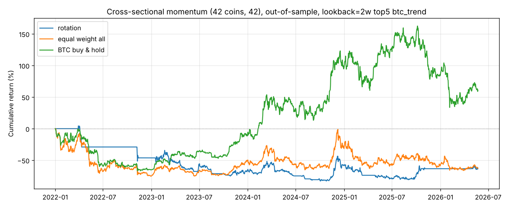
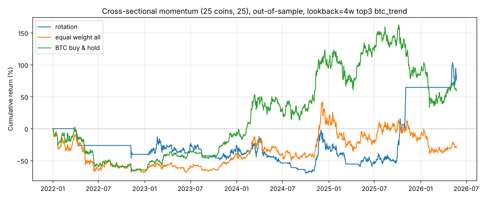
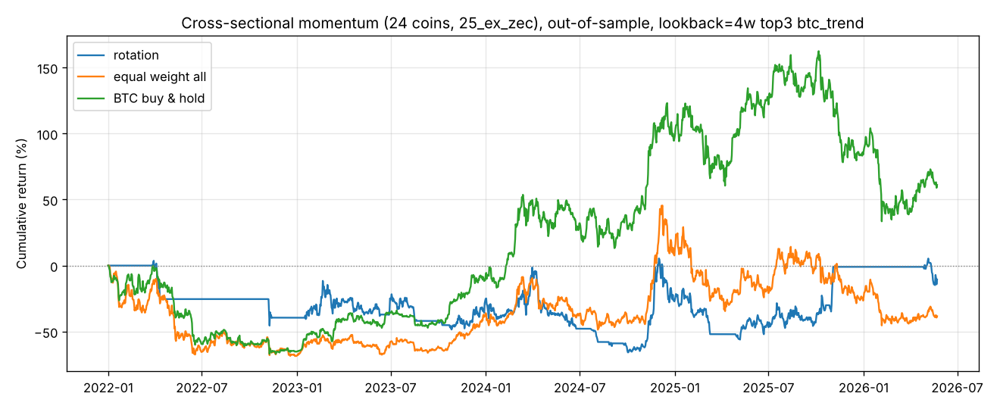

# 横截面动量轮动

由 `python -m money_seeker rotation --universe {25,42} [--exclude zec] --out-dir reports` 生成。
- 每组参数的样本内 / 样本外结果：`rotation_scan_<universe>.csv`；
- 选中参数、安慰剂、基准和分年度收益：`rotation_summary_<universe>.json`。

## 策略

每周日收盘，按过去 L 周的涨跌幅给所有可交易的币排序，持有前 K 名，等权配置。
- **可交易**：当天有价格，且上市满 26 周，避免刚上市的币干扰排序。
- **成交与成本**：周一收盘成交，一周内持仓随价格漂移，调仓时按实际换手收取 0.1% 手续费。

参数网格共 54 组：
- 回看期 L ∈ {1, 2, 4, 8, 13, 26} 周；
- 持有数 K ∈ {1, 3, 5}；
- 过滤方式三选一：
  - 无过滤，始终满仓；
  - `abs`：只持有自身涨幅为正的赢家，其余仓位放现金；
  - `btc_trend`：BTC 低于 20 周均线时全部空仓。

**方法**：
- 在样本内（2018-08 ~ 2021-12）按夏普选一组参数，在样本外（2022-01 ~ 2026-05）检验。
- **安慰剂检验**：每周持有币数和过滤规则都与真实策略相同，但从可交易币中随机挑选，共跑 300 次，看真实夏普排在第几。这样能把“选币能力”和“过滤规则/市场整体涨跌”分开。

**两个币池**：
- **25 币**：BTC、ETH 加上一轮的 23 个币，全部是到今天还活着的币，**幸存者偏差较大**。
- **42 币**：再加 17 个币。其中有 FTT（FTX 平台币，跌 99.6%）、SRM（跌 99.98%）、BTG、OMG、FLOW 等崩盘或没落的币，以及 2020 年那批 DeFi 代币。
  2022 年初可交易币数为 41 个，横截面排序更有意义，也更接近当时投资者真正面对的选择。LUNA 在数据源里没有价格，仍然缺失。

## 结果（样本外 2022-01 ~ 2026-05）

| 币池 | 样本内选出的参数 | 样本内 收益 / 夏普 | **样本外 收益 / 夏普 / 回撤** | 安慰剂分位 | 54 组参数中样本外盈利 |
| --- | --- | --- | --- | --- | --- |
| 25 币 | 4 周, 前 3, btc_trend | +4571% / 1.72 | +85% / 0.53 / -70% | 0.99 | 22 |
| 25 币去掉 ZEC | 4 周, 前 3, btc_trend | +4348% / 1.70 | **-11% / 0.24 / -67%** | 0.88 | 7 |
| **42 币** | 2 周, 前 5, btc_trend | +2905% / 1.65 | **-62% / -0.06 / -84%** | 0.80 | **2** |
| 42 币去掉 ZEC | 2 周, 前 5, btc_trend | +2838% / 1.64 | **-79% / -0.27 / -84%** | **0.47** | **1** |

同期基准：

| 基准 | 收益 / 夏普 / 回撤 |
| --- | --- |
| BTC 买入持有 | +61% / 0.47 / -67% |
| 25 币等权（每周再平衡） | -29% / 0.21 / -69% |
| 42 币等权（每周再平衡） | -62% / 0.03 / -75% |

分年度收益（42 币，选中参数）：

| | 2022 | 2023 | 2024 | 2025 | 2026 年初至今 |
| --- | --- | --- | --- | --- | --- |
| 轮动 | -46% | **-37%** | +21% | -11% | +3% |
| BTC 买入持有 | -65% | +155% | +121% | -6% | -13% |
| 42 币等权 | -75% | +95% | +41% | -40% | -8% |

## 结论

**横截面动量轮动在样本外失败了，而且比逐币时间序列动量失败得更彻底。**

1. **样本内极好，样本外极差**：2018–2021 年选出的参数有 +2905%、夏普 1.65，到 2022 年后变成 -62%。
   54 组参数里只有 2 组样本外赚钱。这是典型的“样本内牛市 + 过拟合”。
2. **25 币上的好结果是假象**，来自两个偏差：
   - **幸存者偏差**：只用活到今天的币，等于事先知道谁没有归零；
   - **单币依赖**：ZEC 在 2025 年暴涨。
   去掉 ZEC 就变成亏损；换成更完整的 42 币池，直接大亏。
3. **选币能力接近随机**：42 币去掉 ZEC 后，安慰剂分位为 0.47，和随机挑币没有区别。
   2018–2021 年，上两周涨幅前 5 的币下周平均比全体多涨 0.75 个百分点。2022 年后这个优势缩小到 0.5 个百分点左右，扣掉高换手的手续费后就没了。
   这条策略年换手 30–90 倍，0.1% 的手续费每年就要吃掉 3–9%。
4. **2023 年是反面教材**：BTC 涨了 155%，轮动策略反而亏 37%。
   它不断追入短期暴涨的小币（SRM、BTG、ZRX、1INCH、CRV 等），随后这些币回落。
5. **BTC 趋势过滤仍是唯一有点用的部分**：54 组参数里，带 `btc_trend` 过滤的组样本外表现最好。
   这和前两轮的结论一致：真正有一点稳定作用的是“BTC 下跌趋势中空仓”，不是选币。

**数据说明**：
- 检查过数据异常：BTG 在 2026-01 有一次单日 +1041% 后又 -90% 的异常跳动，SRM 也有类似情况。
  剔除这两个币后结论不变：样本外 -43%，54 组里 2 组盈利。
- 回测引擎和一个独立的“周一到周一”简化计算逐年核对过，结果一致。

本报告不构成投资建议。

## 图

