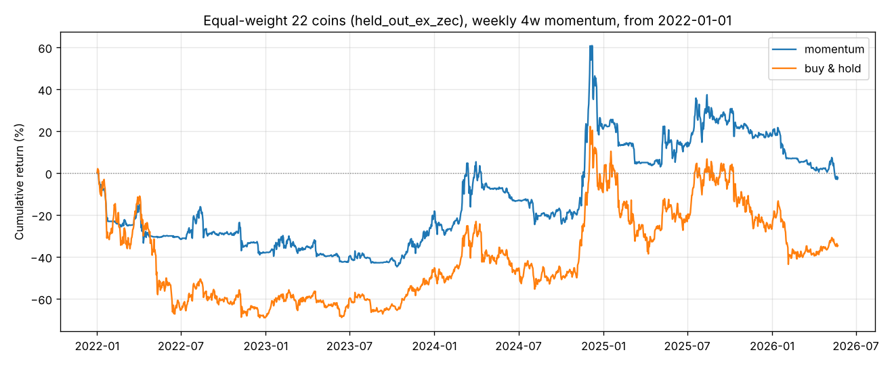
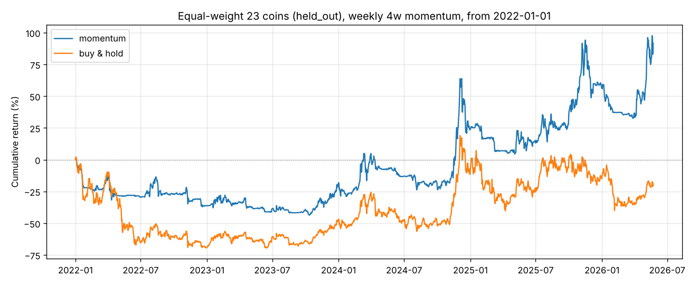
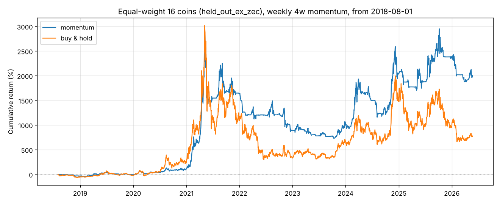

# 多币种验证：周线 4 周动量

由 `python -m money_seeker universe --out-dir reports` 生成。数字来自 `universe_table.csv`（逐币结果）、`universe_summary.csv`（汇总）和 `universe_portfolio.csv`（等权组合）。

## 要检验什么

[上一轮研究](README.md)用 BTC 2016–2021 的数据选出了周线 4 周动量：
每周日收盘看过去 4 周的涨跌幅，为正就满仓持有，否则空仓。
它在 2022 年之后的 BTC、ETH 上都跑赢了买入持有。这一轮**参数不动**，换 23 个选参时没用过的币，检验它是否仍然有效。

- **币种**：LTC、XRP、BCH、ADA、DOGE、LINK、DOT、XLM、ETC、TRX、BNB、XMR、DASH、ZEC、UNI、EOS、NEO、XTZ、ALGO、AAVE、MKR、BSV、ICP。
  这是 Coin Metrics 社区版里所有有价格数据的币（SOL、AVAX 等没有价格数据）。
  其中包括不少后来没落的老币，以减少幸存者偏差。
- **执行方式**：周日收盘出信号，周一收盘按日线成交；单边手续费 0.1%。
- **区间**：
  - `oos`：2022-01-01 ~ 2026-05-23，与选参时间段完全不重叠，是主要证据；
  - `full`：每个币有数据以来的全部历史，与 BTC 选参时间段有重叠，只作参考。
- **安慰剂检验**：把每个币的周线仓位序列整体循环平移，遍历所有平移量。这样持仓时间占比和换手次数都不变，只打乱择时，再看真实夏普在这些“随机择时”里排第几（分位数）。
  2022 年之后多数山寨币跌了 70–90%，**任何一半时间空仓的策略都会“跑赢”买入持有**。
  安慰剂检验就是用来区分“择时真的有效”和“只是空仓少亏”的。分位数 0.5 等于随机择时，越接近 1 说明择时越有效。

## 结果

### 逐币（23 个新币，4 周回看）

| | 2022 年至今（oos） | 全历史（full） |
| --- | --- | --- |
| **赚钱的币** | **6 / 23** | 19 / 23 |
| 收益跑赢买入持有 | 20 / 23 | 19 / 23 |
| 夏普跑赢买入持有 | 14 / 23 | 15 / 23 |
| 最大回撤小于买入持有 | 22 / 23 | 22 / 23 |
| 夏普中位数（动量 vs 买入持有） | 0.17 vs 0.22 | 0.72 vs 0.62 |
| 安慰剂分位中位数 | **0.69** | 0.88 |
| 安慰剂分位 ≥ 0.9 的币 | 3 / 23 | 8 / 23 |

2022 年至今的逐币明细（总收益 / 夏普 / 最大回撤）：

| 币 | 动量 | 买入持有 | 安慰剂分位 |
| --- | --- | --- | --- |
| ZEC | +2154% / 1.25 / -60% | +324% / 0.82 / -91% | 1.00 |
| TRX | +208% / 0.68 / -42% | +374% / 0.82 / -49% | 0.69 |
| BCH | +182% / 0.67 / -54% | -20% / 0.34 / -80% | 0.94 |
| BNB | +90% / 0.56 / -45% | +25% / 0.37 / -63% | 0.88 |
| XRP | +83% / 0.52 / -44% | +60% / 0.52 / -65% | 0.69 |
| XTZ | +12% / 0.32 / -46% | -93% / -0.29 / -93% | 0.95 |
| LINK | -3% / 0.27 / -68% | -54% / 0.23 / -82% | 0.72 |
| XLM | -6% / 0.26 / -72% | -46% / 0.23 / -76% | 0.68 |
| DOGE | -10% / 0.29 / -75% | -40% / 0.32 / -81% | 0.70 |
| ETC | -16% / 0.17 / -46% | -74% / 0.06 / -84% | 0.71 |
| MKR | -16% / 0.22 / -55% | -34% / 0.32 / -80% | 0.59 |
| XMR | -21% / 0.17 / -65% | +55% / 0.50 / -63% | 0.28 |
| LTC | -23% / 0.15 / -67% | -64% / 0.06 / -72% | 0.72 |
| AAVE | -26% / 0.22 / -65% | -67% / 0.22 / -82% | 0.66 |
| BSV | -33% / 0.12 / -69% | -88% / -0.11 / -90% | 0.75 |
| EOS | -43% / 0.05 / -79% | -97% / -0.51 / -98% | 0.84 |
| UNI | -49% / 0.09 / -73% | -80% / 0.12 / -84% | 0.57 |
| NEO | -55% / 0.01 / -71% | -89% / -0.11 / -91% | 0.67 |
| ALGO | -59% / -0.05 / -81% | -93% / -0.23 / -95% | 0.63 |
| ADA | -60% / -0.15 / -72% | -82% / -0.02 / -85% | 0.39 |
| ICP | -60% / -0.01 / -82% | -90% / -0.02 / -94% | 0.60 |
| DASH | -69% / -0.01 / -84% | -67% / 0.23 / -88% | 0.39 |
| DOT | -71% / -0.29 / -73% | -95% / -0.44 / -96% | 0.53 |

### 等权组合（开始时资金均分到每个币，之后各自独立运行、不再平衡）

| 组合 | 起点 | 动量 总收益 / 夏普 / 回撤 | 买入持有 总收益 / 夏普 / 回撤 |
| --- | --- | --- | --- |
| 23 个新币 | 2022-01 | +92% / 0.58 / -44% | -19% / 0.23 / -70% |
| **去掉 ZEC 的 22 个币** | **2022-01** | **-2% / 0.16 / -45%** | -35% / 0.15 / -70% |
| 去掉 ZEC 的 16 个币 | 2018-08 | +1986% / 0.98 / -72% | +772% / 0.76 / -87% |

2022 年以来 23 币组合的 +92%，几乎全部来自 ZEC 一个币（2025 年暴涨，动量在这个币上 +2154%）。
去掉 ZEC 后，组合 4 年多收益约为 0，夏普和买入持有基本一样。

其他回看期在 2022 年以来、去掉 ZEC 的组合上：8 周 -14%，13 周 +8%，26 周 -19%，52 周 -13%，没有一档明显赚钱。

## 结论

**周线 4 周动量在更多币种上没有通过“赚钱”这一关。**

1. **大多数币不赚钱**：选参时没用过的 23 个币里，2022 年以来只有 6 个赚钱。
   去掉一个极端值（ZEC）后，等权组合收益约为 0。BTC、ETH 上的漂亮结果有相当成分是运气。
2. **它确实能大幅减少亏损和回撤**：23 个币里 22 个最大回撤更小，20 个收益好于买入持有；
   等权组合的最大回撤从 -70% 降到 -45%。但这主要来自“下跌趋势里空仓”，并不是择时赚钱。
3. **择时能力很弱**：2022 年以来安慰剂分位中位数 0.69，只比随机择时（0.5）好一点；分位 ≥ 0.9 的币只有 3 个，接近纯随机时预期的 2.3 个。
   全历史里这个分位是 0.88，说明动量**过去**有效，但在近几年明显衰减。这与“加密市场成熟后趋势效应减弱”的说法一致。
   由于全历史和 BTC 选参时间段重叠，这部分证据本来也打了折扣。
4. **回看期也不稳定**：2018 年以来的组合里，4 周一档 +1986%，但 8/13/26/52 周都跑输买入持有，单独一档特别好本身就是可疑信号。

**可以怎么用**：把它当作**风控层**是合理的。下跌趋势中空仓，回撤能小一截；但不要指望它本身创造收益。
如果目标是找到稳定盈利的策略，这条路线需要换思路，例如：
- 横截面动量：每周持有过去表现最好的几个币，而不是逐币判断涨跌；
- 波动率调仓位（vol targeting）；
- 与链上、资金费率等非价格因子结合。

这些都需要同样的样本外和安慰剂检验。本报告不构成投资建议。

## 图

